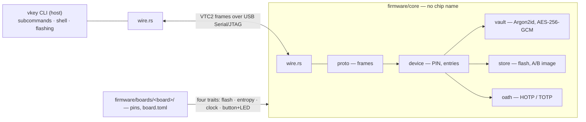

# vkey — a hardware key for TOTP codes, passwords and `.env` files

Your project's `.env` and your TOTP seeds on a $6 board instead of on your disk and in your
phone. An open-source USB-C key on a Waveshare ESP32-C6-Zero: bare-metal Rust firmware, a
single-binary host CLI, and a press of the board's button for every secret that comes out.

> **Status: a personal key, not a product** (2026-09-07). It runs on real hardware, its TOTP is
> checked against the RFC 6238 vectors, and the author uses it for his own accounts. No sales, no
> batch, no certification. Read [docs/threat-model.md](docs/threat-model.md) before relying on it,
> and keep the recovery codes your services give you.

> **Two boards** (2026-10-13). Development now targets the Makerdiary nRF52840 MDK USB Dongle
> (`firmware/boards/nrf52840-mdk-dongle`), which also holds passkeys (FIDO2, since
> 2026-10-15) and answers `sudo` through them. It runs the same
> core and passes the full lifecycle test. Its bootloader is now our own fork, which runs
> only signed firmware and serves no flash back, and APPROTECT closes its debug port. This
> revision-2 chip can still be glitched open, though, and it has no chip key
> ([docs/threat-model.md](docs/threat-model.md)). So it is **not for real secrets** until the steps
> in [docs2/roadmap.md](docs2/roadmap.md) are done, and `vkey setup` does not flash it yet.
> Everything below still describes the ESP32-C6-Zero, which is now only a test board.

## In ten seconds

```console
$ vkey totp add GitHub:me
stored 'GitHub:me' - codes need a tap on the button

$ vkey get GitHub:me
tap the BOOT button on the board...
734128   (17s left)  copied
```

```console
$ vkey env add myapp .env
stored 'myapp' - it comes back whole after a tap:  vkey get myapp

$ rm .env                      # the project's secrets are off the disk now

$ env $(vkey get myapp) npm start
tap the BOOT button on the board...
```

Nothing came back without a press, and the TOTP secret behind that code has no way out of
the device under routine use — only an explicit export under a double tap reads it back.

## What it is

- **TOTP secrets**, **passwords** (login, password, note) and whole project **`.env` files**,
  encrypted with AES-256-GCM.
- The key comes from an 8-digit PIN through Argon2id (128 KiB) and an HMAC key burned into eFuse,
  so a flash dump without the chip is useless. Eight digits and not fewer: whoever holds the board
  can erase the attempt counter through download mode and guess through the firmware at ~1.3 s a
  try, which is four years for eight digits and a fortnight for six. JTAG is disabled; Secure Boot
  v2 (RSA-3072) is on; Flash Encryption is deliberately not used.
- Every code, password and `.env` needs a button gesture. Eight wrong PINs wipe everything.
- A TOTP secret leaves the key in the clear only under an explicit double tap (`vkey export <name>`).
  Routine use returns only codes. `vkey backup` reseals every item under a
  backup passphrase without revealing secrets.
- Everything, `list` included, needs the PIN — except a passkey or a `vkey auth` login on the
  nRF52840, a tap alone; the key re-locks after two idle minutes. Secrets and
  PINs are never arguments or environment variables — hidden prompt or stdin.

## What it does not do

Read [docs/threat-model.md](docs/threat-model.md) **before** you depend on this.

- **Phishing, for TOTP and passwords.** A TOTP code works on a fake site just as on the real one;
  that is a property of TOTP. The browser binds a passkey to its site, and only the nRF52840
  board has passkeys: the C6's USB is a fixed Serial/JTAG port with no HID.
- **Nothing for the code or password you just received** — it crosses the host: terminal, optionally
  the clipboard. The clipboard is cleared after 30 s, but a clipboard manager has already kept its own
  copy, and the reveal stays in the terminal's scrollback until the window closes. Details in the
  threat model.
- ESP32 is **not a secure element.** Against power glitching and side channels it does not hold; a
  public Secure Boot glitch bypass for ESP32-C3/C6 exists (Espressif AR2023-007). Download mode
  stays open on purpose: anyone holding the board can rewrite the flash.
- A backup is only the `.vkb` file you made: with the passphrase it is every secret, without it the
  file opens nowhere.
- No NFC, no phone — USB-C to a computer only. Against a state actor, or someone with a soldering
  iron, buy a certified key with a secure element instead.

## Install

One static binary, no Python and no ESP-IDF; the firmware image is embedded in it.

```bash
curl -fsSL https://github.com/vaulttec-dev/vaulttec-key/releases/latest/download/install.sh | sh
```

x86_64 Linux. The script checks the download against the published `SHA256SUMS` and
refuses to install on a mismatch, needs no root, and writes only `~/.local/bin/vkey`.
[Read it first](install.sh) — you should, for any piped installer.

From source, which needs only Rust ([rustup](https://rustup.rs)):

```bash
git clone https://github.com/vaulttec-dev/vaulttec-key.git
cd vaulttec-key/cli && cargo build --release && ./target/release/vkey install
```

Either way, put `~/.local/bin` on your PATH and run `sudo usermod -aG dialout $USER`, then
log back in — without that group the serial port will not open.

## Quick start

Plug a bare board in over USB-C and run `vkey setup`: it flashes the firmware, asks for a PIN and
runs the self-test. `vkey` alone opens the shell, where an entry's name *is* a command: `github` +
Enter gives a code after a tap; `mail` + Enter gives the login at once and the password after a tap.
Empty Enter opens the entries as a menu with three tabs — TOTP, Passwords, ENV — where `a` adds,
`e` edits, `d` deletes and `i` imports.

```bash
vkey totp add GitHub:me               # asks for the otpauth URI or base32; or: echo SECRET | vkey totp add name
vkey pass add mail --login me@example.com
vkey env add myapp .env               # or: wl-paste | vkey env add myapp
vkey get GitHub:me                    # a code; vkey get mail [--copy] for a login and password
vkey get myapp > .env                 # better without a file:  env $(vkey get myapp) npm start
vkey list · rm · info · lock · pin set/change · totp selftest · wipe
vkey op [query]                       # mirror 1Password (passwords, TOTP, notes, developer .env)
vkey import passwords.csv             # Google Password Manager or 1Password CSV export (skips unchanged)
vkey backup vault.vkb                 # everything, the nRF's passkeys too, sealed on the key; two taps
vkey restore [file]                   # restore from 1Password, CSV, or .vkb backup file
vkey restore --only NAME file.vkb     # just that item out of a backup, nothing replaced
vkey check --wipe-everything          # lifecycle test on a board; ERASES EVERYTHING
sudo vkey auth enable                 # sudo and the lock screen with a tap (below)
```

A `.env` is stored as is and comes out whole after one tap; only `KEY=value` lines are accepted,
checked by the CLI. A CSV export is plaintext on disk before and after `vkey import`, and the CLI
does not delete it. `vkey op` syncs directly with the 1Password CLI (`op`) without plaintext files
on disk, automatically skipping unchanged items.

A sync mirrors its source both ways: an entry the source no longer offers is deleted from the key,
and the deletion is printed. It reaches only what that same source owns — which source each
entry came from is remembered in `~/.config/vaultkey/sources.json` — so a 1Password sync never
touches what a CSV brought, and an entry under a name no source offers is left alone. Narrowing the run with `--tag`,
`--vault` or a single item makes it a selection rather than a mirror, and a selection only adds.

## sudo and the lock screen with a tap

With the nRF52840 key plugged in, `sudo` and the lock screen take a tap instead of your
password; without it they ask for the password as always, and with it but no tap, once the
key gives up after 30 s. This is `pam_u2f`, the scheme every FIDO2 key uses: the key makes
a credential for this host, the host keeps only its public half. It needs no PIN, so a
stolen laptop with the key still in it opens with a tap — read
[the trade-off](docs/threat-model.md#vkey-auth--sudo-and-the-lock-screen-with-a-tap-through-pam_u2f)
first.

```bash
sudo apt install libpam-u2f
sudo "$(command -v vkey)" auth enable    # two taps: sudo and the lock screen are set up
sudo "$(command -v vkey)" auth disable   # back to the password alone
```

`enable` makes a credential on the key (a tap), tries it the way a login will (another
tap), writes it to `/etc/u2f_mappings` (root's), and adds
one line to the PAM files of `sudo` and of the lock screens this host has — COSMIC, GNOME,
KDE, sway, Hyprland — keeping each original as `*.before-vkey`. A file it does not
recognise it leaves alone and prints the line to add by hand. Keep a root shell open in
another terminal until `sudo` and the lock screen have both worked, with the tap and with
the password.

In the shell, `/settings` → `auth` does the same in one step, and installs `libpam-u2f`
with apt first if it is missing.

## Git commits signed with a tap

```bash
vkey commits enable    # a tap: an SSH key on the key, git signs every commit with it
vkey commits disable   # git stops signing; the key stays for the next enable
```

`enable` makes an OpenSSH `ecdsa-sk` key on the nRF52840 (a tap) and keeps its handle in
`~/.ssh/id_vkey_sk`, which signs nothing without the key. It sets git's `gpg.format`,
`user.signingkey`, `gpg.ssh.allowedSignersFile` and `commit.gpgsign` globally, refuses
to overwrite a signing setup that is not its own, and offers to add the public half to
GitHub as a signing key (`gh`), so the commits show as verified there. From then on every
commit waits for a tap. In the shell it is `/settings` → `commits`, on or off. Linux only
for now; macOS and Windows are issues #18 and #19. What it costs is in
[the threat model](docs/threat-model.md#git-commits-signed-with-a-tap).

## Gestures and capacity

| Gesture | LED | What it releases |
|---|---|---|
| Tap | amber | one TOTP code, the secret fields of one item, one `.env`, one passkey, one `vkey auth` login, or one signed git commit |
| Hold 5 s | red | factory wipe: every secret and the PIN; on the nRF52840, erasing every passkey (within 10 s of plugging in) |
| Double tap | blue | the encrypted backup file, or an export / seed readout |

A tap never wipes and never exports, so a hostile host cannot swap a code request for a
wipe or an export: the gesture the owner makes for one satisfies neither of the others.
A TOTP seed leaves the key in the clear only under the double tap, and only because
`vkey export` writes an item back into 1Password whole — what that costs is written out
in `docs/threat-model.md`.

| | Limit |
|---|---|
| Items (every category together) | 256 |
| Fields per item | 32 |
| One field | 8056 bytes — a `.env`, an SSH key, a note |
| One item | 8192 bytes, packed |
| The vault | ~210 KB, two copies; a write costs what the vault holds, not what it might |
| Item name | 32 bytes; names are one namespace |
| PIN | exactly 8 digits, 8 attempts |
| Backup passphrase | 12–128 characters; five or six random words, not an invented one |

## Build

> **Upgrading a key whose PIN is shorter than eight digits: change the PIN first.** From
> version 0.9 a PIN is exactly eight digits, checked before anything is sent, so a key holding
> a six- or seven-digit PIN will not unlock under the new firmware — and a vault that does not
> unlock is a vault that is gone. With the *currently installed* `vkey`, run `vkey pin change`
> to an eight-digit PIN, then build and flash. A short PIN costs no attempt and cannot wipe the
> key; it simply never opens it.

```bash
rustup target add riscv32imac-unknown-none-elf && cargo install espflash   # once
./tools/build-vaultkey.sh                     # every board, no-radio check, images into the CLI
./tools/sign-vaultkey.sh                      # Secure Boot: sign the images (PIN and a tap)
(cd cli && cargo build --release) && cli/target/release/vkey install && vkey setup
./tools/build-bootloader.sh                   # only when firmware/boards/*/bootloader/ changes (Docker)
```

The signing key lives on the key itself, as the `.env` entry `vkey-signing`. Acceptance after any
firmware change: `vkey totp selftest` green — one tap, destroys nothing. Before a release and on
every new board also `vkey check --wipe-everything`, which erases the device, so run that one on an
empty board and never on a key holding secrets. A new
board is a folder `firmware/boards/<name>/` with its pins, chip crates and `board.toml`; the CLI
picks it up at build time. Git hooks in `.githooks/` run fmt, clippy (`pedantic` as errors), tests,
shellcheck, the no-radio and wording checks, and prove the committed image equals a fresh build.

CI runs the same set on every pull request, plus `cargo audit` weekly, a spell check,
`actionlint` and `zizmor` over the workflows themselves. The job worth knowing about is
`images`: it rebuilds the firmware from source, fails if the committed binary differs by a
byte, and verifies both signed images against `firmware/secure-boot/public.pem` — no secret
involved, so anyone can repeat it. That is the only honest reason to trust a firmware image
published as a binary.

## How it works



`wire.rs` is one file compiled on both ends of the cable: a command, error code or flag
that is not in it exists on neither side. The device has no clock — the host sends the time.

## Layout

| Path | What |
|---|---|
| `firmware/core/` | the key itself: protocol, PIN, crypto, storage, TOTP — no chip name |
| `firmware/boards/<board>/` | one folder per board: pins, chip crates, `board.toml`, images |
| `cli/` | the `vkey` command: subcommands, shell, flashing (espflash as a library) |
| `tools/` | build, signing and check scripts |

| Document | About |
|---|---|
| [docs/threat-model.md](docs/threat-model.md) | what it protects against and what it does not. **Read first** |
| [docs/hardware.md](docs/hardware.md) | the C6-Zero board: measured pins, traps, bringing up a new one |
| [docs2/roadmap.md](docs2/roadmap.md) | the nRF52840 board, from bring-up to daily use |
| [docs2/makerdiary.md](docs2/makerdiary.md) | the nRF52840 board: why this one, its factory state, what was measured |

## Security and licence

Report vulnerabilities privately — see [SECURITY.md](SECURITY.md). Please do not open a
public issue for anything in the crypto, PIN handling, storage or host protocol.

Licensed under [Apache-2.0](LICENSE).
