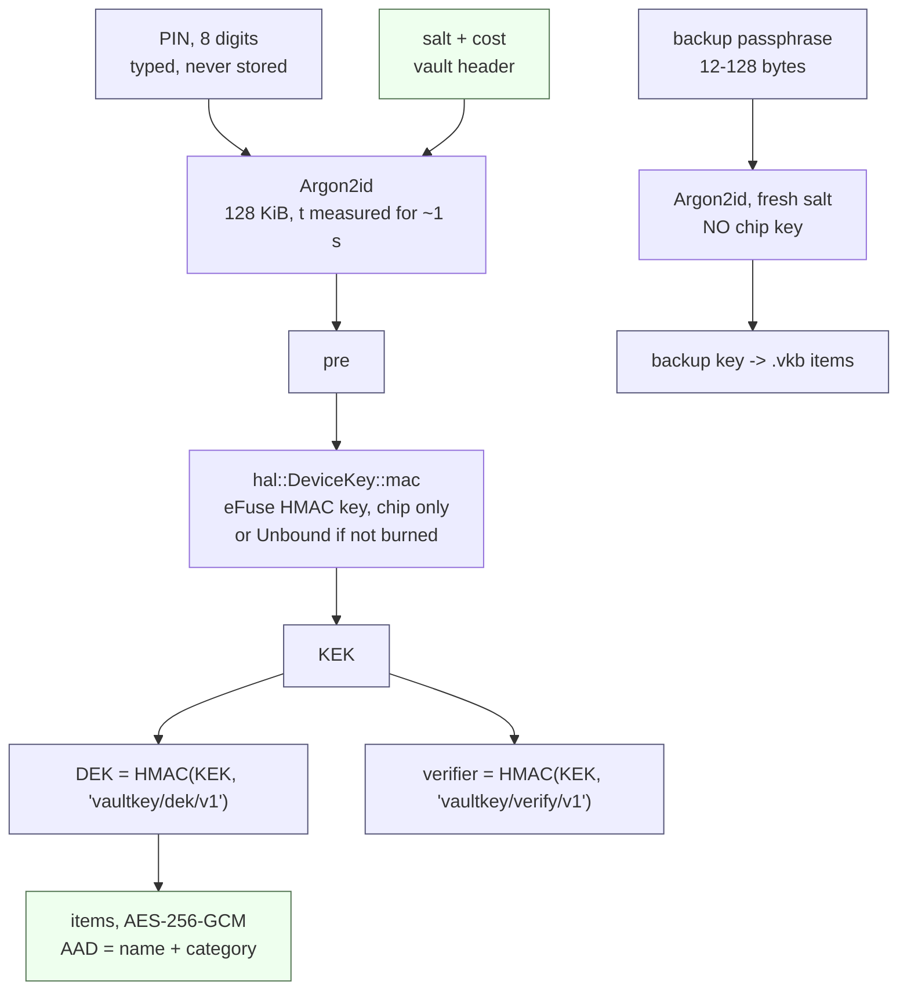

# Threat model

> The main document of this project. Written **before** any sale, not after. Its purpose
> is that nobody uses this key believing it protects against something it does not.
> There is no sale today, and the document holds all the same: the owner must not rely
> on guarantees the device does not give.

Last reviewed 2026-09-12; the nRF52840 board section added 2026-10-13, its signing key
and bootloader fork 2026-10-14, its passkeys 2026-10-15. Revisited on every
hardware or firmware change. Reporting policy: [`SECURITY.md`](../SECURITY.md). Board
details: [`docs/hardware.md`](hardware.md).

## The nRF52840 board: not for real secrets yet

The rest of this document describes the ESP32-C6 key. The second board,
`firmware/boards/nrf52840-mdk-dongle` (Makerdiary MDK USB Dongle), runs the same core and
passed `vkey check --wipe-everything` on 2026-10-13. Its protection is much weaker today,
and every guarantee below that rests on the eFuse key, JTAG being off or Secure Boot does
**not** hold on it:

- **No chip key.** `DeviceKey` is unbound, so the data key comes from the PIN and Argon2
  alone (128 KiB, 20 passes - about a second on this 64 MHz core). The eight-attempt wipe
  only guards the device's own PIN check. Whoever copies the flash can try every PIN on
  their own hardware. Measured 2026-10-13 with the same `argon2` crate on one laptop core:
  0.97 ms per guess at 20 passes (2.4 ms at the C6's 48). All 10^8 PINs then take about
  28 core-hours, a few hours on an ordinary laptop, and less on a GPU. The "years for
  eight digits" figure is for the C6 with the counter erased; it does not apply here.
- **The flash can be copied only with a glitch.** The chip is revision 2 (build code
  `AAD0`). Since 2026-10-15 its firmware has written UICR `APPROTECT` to Enabled
  (`0xffffff00`, phase 4), which closes the debug port from the next reset on, for good.
  Revision 2 predates Nordic's fix for the published APPROTECT voltage glitch (IN-133),
  so someone with glitching gear can still open the port at boot and read the flash. A
  chip key would fall the same way, which is why there is none (roadmap, phase 5).

  The USB drive no longer hands it out. The factory UF2 bootloader served `CURRENT.UF2`,
  the whole application area, to anyone who held the button while plugging the key in.
  On 2026-10-13 the vault's region came back with its contents. Our bootloader fork
  replaced it on 2026-10-14, and its drive holds only `INFO_UF2.TXT` and `INDEX.HTM`. Raw
  sectors past them read as zeros: checked on the board where the factory's drive had
  served its own code.
- **Only firmware signed with the fork's key runs** (since 2026-10-14). The fork checks
  the signature on every boot. On the board it refused an image with one bit flipped and
  an image signed with another key, and it ran the signed vkey. Whoever holds the button
  can still write the application region, so a bad copy leaves the board in the
  bootloader until a signed image is copied.
- **`vkey auth` is a passkey here** (since 2026-10-15): `pam_u2f` over the board's FIDO2,
  in place of the old scheme, which needed a chip key. Its section below says what that
  costs.
- **The bootloader fork's signing key lives on this board.** It is the `.env`
  `vkey-signing-nrf`, made by `bootloader/signing-key.sh` on 2026-10-14 (fingerprint
  `a1700ebd539b0bfc`), with a `.vkb` as its second copy. That copy was proven twice, each
  time by a restore that signed byte for byte the same, the second after the wipe test.
  Everything above applies to it:
  - for 1 h 17 min, until the fork was installed, `CURRENT.UF2` and the offline PIN search
    handed it to anyone who held the board for a minute and then computed for a few hours;
  - then SWD did the same, until APPROTECT closed it on 2026-10-15 (phase 4); since then
    it takes the glitch.

  Whoever has the key signs firmware the fork runs. By design, the fork moves to a new key
  only through a self-update signed with the old one. A leak is mended only while the
  owner still holds the key.
- **The C6's Secure Boot key lives here too** (since 2026-10-15): `vkey-signing`, added
  from the C6's `.vkb` by `vkey restore --only`, so the C6's images are signed without
  touching the C6. Whoever takes it off this board signs firmware the C6 boots; the C6
  holds no real secrets, and its own copy stays where it was.
- **A backup made on this board uses its own cost** (20 passes). It is still guarded by
  the passphrase's entropy, at less than half the C6's work per guess.
- **Passkeys (FIDO2) live outside the vault** (since 2026-10-15, roadmap phase 6).
  Trussed and fido-authenticator keep them in a littlefs of their own at
  0xD8000..0xEC000:
  - **They are not sealed under the PIN.** Trussed writes its keys as they are: the
    passkeys' private keys, and the key that wraps the credential IDs of the
    non-resident ones (`pam_u2f`'s among them). The glitch above reads them straight
    off the flash. No PIN search is needed, so a passkey falls in the minutes the glitch
    takes, where the vault takes hours more.
  - **A tap is enough, locked or not.** Registration and login take the vault's tap
    (amber, a fresh press after the request), never the vkey PIN. A FIDO PIN, if one is
    set through a browser or `fido2-token`, belongs to fido-authenticator. It gates what a
    site asks it to gate and encrypts nothing.
  - **Nothing leaves over USB.** No CTAP command returns a private key. U2F (CTAP1) is
    not served at all: its presence check polls every 250 ms, and a tap that must start
    after the request cannot answer that.
  - **Erasing them takes the wipe's gesture.** authenticatorReset erases every passkey,
    so it needs the 5 s hold (red), not a tap, and fido-authenticator accepts it only in
    the first 10 s after the key is plugged in. The vault's own wipe,
    `check --wipe-everything` included, does not touch them: they sit in another region.
  - **Origin binding.** The browser binds a passkey to its site's origin, so a look-alike
    site gets nothing it can use: the property WebAuthn has and TOTP lacks. TOTP codes and
    passwords from the vault stay as phishable as anywhere.
  - **They are in the backup, under its passphrase** (milestone 5): a deliberate break
    from FIDO's rule that they never leave (maintainer's decision, 2026-10-15). `vkey
    backup` carries Trussed's whole filesystem after the items, as sealed 4 KiB sectors:
    every passkey, the key that wraps the non-resident credentials (`pam_u2f`'s among
    them), the signature counters. They leave only after the double tap, like the items.
    Passkeys are not served while the backup runs, so the copy is never torn.
    - Whoever has the `.vkb` and its passphrase has the passkeys. Restored onto another
      nRF52840, they make a clone that answers every site and this host's `sudo`.
    - A restore replaces the passkeys with the PIN alone and no gesture, as it replaces
      the vault. A file with no passkeys leaves them as they are.
    - Restoring an older backup winds the signature counters back. A site that checks
      them may take the key for a clone.
    - A restore cut short leaves the region torn. The key formats it on its next start,
      which also loses the `sudo` credential, until the restore runs again from the file.
    - The C6 takes an nRF backup's items and leaves the passkeys in the file, named.

    Losing the key with no backup still loses them, so every site keeps a second way in.

**Accepted, not fixed** (maintainer's decision, 2026-10-13): this revision-2 chip will hold
everything once the steps below are done. The glitch above stays open after them. Someone
who takes the key and has the gear reads the flash and finds the PIN offline in hours. For
a personal key, that risk is accepted rather than paid for with a revision-3 dongle.

Before this board holds a real secret, two things are required:
- our own fork of the UF2 bootloader, which runs signed images only, serves no read-back
  and writes only to the application region (accepted 2026-10-14);
- APPROTECT (written 2026-10-15).

A chip-bound key, a secret in a flash page locked by the ACL until reset, was the third.
It was dropped on this revision (2026-10-15): it loads from flash at boot, so the glitch
above reads it as well, and it would protect nothing the PIN does not already. On a
revision-3 chip it would be worth having. The plan is in `docs2/roadmap.md`. Nordic's secure bootloader was dropped from it: there is
no SWD probe, and installing it moves the bootloader address in UICR, a one-shot change
with no way back.

## What the device is

A USB key on an ESP32-C6 running its own firmware (`firmware/core` plus a board
directory). It stores TOTP secrets, passwords and project `.env` files under
AES-256-GCM, keyed from an 8-digit PIN that is never stored. Every code, password and
`.env` requires a physical button press; eight wrong PINs in a row wipe every secret.
A TOTP seed leaves the key in the clear only under an explicit double tap (`vkey export`).
Routine code generation never reveals seeds. Passwords and `.env` files
do pass through the computer. The only other path a secret takes out is the encrypted backup below.

**This is not a secure element and not a certified device.** It is a general-purpose
microcontroller. JTAG is disabled by eFuse, the data key passes through an eFuse HMAC
key (2026-09-08), Secure Boot v2 is enabled (2026-09-09). Flash Encryption is **not**
enabled and is not planned: secrets are already under AES-256-GCM behind the eFuse HMAC,
the vault is written as raw words through `esp-storage`, which FE does not support, and
FE would protect only firmware code that is open anyway.

## Key derivation

Blue exists only in RAM while unlocked and is zeroized on lock; green lives in flash.
An unlock is checked against the verifier; nothing derived from the PIN is stored.

| Choice | Reason |
|---|---|
| Argon2id, 128 KiB, no allocator | Memory hardness costs an attacker more than PBKDF2 does — but 128 KiB is what the board can spare beside an 80 KiB vault and a 300 KiB stack (since 2026-10-15 it is taken on the stack for each derivation and scrubbed after it; the nRF52840 paints its stack at boot, so a reset mid-derivation leaves nothing behind), and it fits in the cache of any desktop core, so it buys time, not the memory bandwidth Argon2 is meant to charge for. Against the PIN that changes nothing (the counter and the eFuse key do the work); against a stolen `.vkb` it is the whole defence, hence the passphrase rule below |
| Cost `t` in the vault header, bounded above | A forged header cannot park the key for hours |
| Not `scrypt`, not `balloon-hash` | `scrypt` needs `alloc`; `balloon-hash` doubles the crypto crates |
| PIN exactly 8 digits (0.9; was 6–8) | The counter can be erased through download mode, so the real cost of a guess is one firmware unlock, ~1.3 s. That is a fortnight for six digits, five months for seven and four years for eight — the only lever is length, because a slower KDF makes every honest unlock slower too. A PIN of the wrong length is refused before the wire and costs no attempt |
| Chip key as a trait, `hal::DeviceKey` | The board supplies `esp_hal::hmac` when `KEY_PURPOSE_0 = HMAC_UP` (`ChipKey::detect`), else `Unbound`; the header records the binding, so firmware answering differently returns `Incompatible` instead of burning attempts |
| Category in the AAD with the name | The category sits in flash as plaintext; putting it in the AAD ensures that rewriting the category byte causes AEAD decryption to fail, so the item opens for nobody |

The eFuse burn of 2026-09-08 put 32 bytes from `/dev/urandom` into `BLOCK_KEY0`, purpose
`HMAC_UP`, read and write disabled, and set `DIS_USB_JTAG` and `DIS_PAD_JTAG` = 1. No copy
was kept (`shred`): a key in a file makes a flash dump useful again. The vault written
before the burn became `Incompatible` and was wiped.

## Gestures and field classes

| Gesture | Action | LED |
|---|---|---|
| Tap | code, the secret fields of an item, a `.env`, a passkey, a `vkey auth` login | amber |
| Hold 5 s | wipe; on the nRF52840 also erasing every passkey | red |
| Double tap, 800 ms window | encrypted backup, **and an export or seed readout** | blue |

A tap never wipes and never exports; a hold never exports; a double tap never wipes. One
gesture would defend badly: a hostile host asks for a wipe exactly when the owner expects
a code, and the same reflex hands it over. A new command with consequences gets a new
gesture, never an existing one.

An item is a list of fields, and it is the **class of the field** - not the category of
the item - that decides what may leave. This replaced the entry kinds on 2026-09-19,
when the key became a mirror of a whole 1Password vault: a credit card carries a number
anyone with the PIN may read and a CVV that needs a tap, and one kind per item could not
say that.

| Class | May ever leave the device | Gesture |
|---|---|---|
| `Open` | The value, under the PIN alone: a login, a URL, an account number, an issuer | none |
| `Secret` | The value: a password, a note, a CVV, a private key, a whole `.env` | tap |
| `Seed` | A **code** computed from it on a tap; the seed itself only under the export gesture | tap / double tap |

The host names a reach with every request and the device hands back only the fields of
that reach - the rest are not in the answer at all. An unknown reach byte is refused
rather than rounded down. A host that writes a seed marked `Open` gains nothing: it holds
that seed already; the class guards the next read, not this write. The class lives inside
the sealed item, so there is no plaintext class byte in flash to rewrite; the category
beside it is plaintext, and it is under the AEAD tag, so rewriting it - even with the CRC
repaired - leaves an item that opens for nobody.

A password comes out on the same tap as a code (2026-09-08): for a single owner a separate
2 s hold cost more than it protected, and it is **not coming back**. The price: a hostile
host asking for a password while the owner expects a code gets it — but only for an entry
whose name it knows, only while unlocked by PIN, one per press. A `.env` is the same tap
and the most expensive on the key, releasing every secret of a project at once; with no
file on disk that is the only way to launch the project, and a separate gesture would add
nothing beyond PIN plus tap.

### A seed can now leave in the clear

This is the maintainer's decision of 2026-09-19, and it costs something real. Until then
this document said a TOTP seed had no path out of the device at all: a backup carried one
only sealed under a passphrase, so the host saw ciphertext and nothing else.

`vkey export` ends that. Writing an item back into 1Password means writing the item that
was taken - one-time password included - and `op item create` takes a plaintext
`otpauth://` URI. So a seed leaves in the clear, under the double tap, the same gesture a
backup costs, because it is the same act: a whole secret leaving the key.

What that buys the owner is a mirror that runs both ways. What it costs is the hardware
boundary itself: **a key that can write its secrets back into a cloud manager protects
them only as well as that manager does.** After an export, the seed's security is
1Password's, the host's, and whatever else can read that process - not this device's. The
gesture keeps it from happening behind the owner's back; it does not make it safe.

Unchanged: a tap never exports a seed, an auth secret is never exported at all (`vkey
auth` is this machine's login and 1Password has no use for it), and an item without a
seed costs no double tap to export - only the tap its secrets already cost.

## What it protects against

| Threat | Verdict |
|---|---|
| Malware copying the secret database off the host | Yes, while the owner does not export: a secret comes back out only under a gesture - a tap for a password, two for a seed - one item per press, never in bulk without the button |
| Silent code generation in the background | No code without a **new** press: a held or taped-down button does not count — confirmation is a press with a release, after the request |
| A wipe disguised as a code request | Yes — different gesture, different LED |
| A password request disguised as a code request | No — same tap, deliberately (above) |
| An ordinary thief with the board | Yes, through the protocol: PIN plus a wiping attempt counter, the attempt spent **before** the check, so cutting power mid-check buys no free attempts |

Honest boundary: none of this stops the owner (eight wrong PINs or `espflash erase-flash`
wipe just as well), and it does not protect against anyone holding the board with
equipment and time. It protects against what the owner did not intend to do.

### Backup — encrypted, and only on a double tap

`vkey backup` (2026-09-09) writes every entry and `.env` blob into one `.vkb` file. Each
item is sealed by **the device itself** (AES-256-GCM) as `kind | name | secret` under a key
derived from a backup passphrase (Argon2id, fresh salt, same cost as the PIN; 12–128
characters, because the file is brute-forced offline with no attempt counter) and
**without** the chip key, or the file would not open on another board. Twelve characters
is a floor the frame enforces, not advice: at 128 KiB the KDF blunts a GPU rather than
stopping it, and the entropy has to come from the passphrase itself. **Five or six words
chosen by dice** — which is what the CLI asks for — and never a phrase a person invented,
because that is the one place in this design where a weak choice loses everything at once. The host assembles
the file (`cli/src/backup.rs`) and never looks inside: a TOTP secret does not leave in the
clear here either. `BACKUP_AAD` plus the item index covers each item's position, so a
reordered, substituted or repeated item does not open; a truncated file restores what it
holds and reports how much; the first item *is* the passphrase check (`BadBackup`, nothing
written).

What this changes: a file now exists that, with the passphrase, equals every secret, and
its strength is the passphrase's — keep it where you keep other backups, and the
passphrase elsewhere. Host malware during `backup` gets the same ciphertext the owner
gets; it cannot swap a code request for an export, and it can substitute its own
passphrase only if the owner happens to double tap, which is never needed otherwise.
`vkey restore` writes the file back under PIN with no gesture, like `add`: nothing comes
out, a duplicate name replaces, and entry versus blob the newer one from the file wins.
Rejected: a flash-image copy as backup — PIN-encrypted, 8 digits fall offline in days, and
it does not transfer while bound to the chip key.

### `vkey auth` — sudo and the lock screen with a tap, through `pam_u2f`

Since 2026-10-15 `vkey auth` is the scheme every other key uses: `pam_u2f` over FIDO2, on
the nRF52840's passkeys (maintainer's decision, 2026-10-03). `sudo vkey auth enable` makes
a non-resident credential for `pam://<host>` after a tap, tries it with an assertion after
a second tap, and only then writes its public half to `/etc/u2f_mappings` (root's, 0644),
replacing only that user's line. It speaks CTAP2 itself (`cli/src/fido.rs`) rather than
run `pamu2fcfg`: the 1.1.0 that distributions ship demands an attestation certificate, and
this key attests with the credential's own key. Each PAM service this host has among `sudo`, `cosmic-greeter`, `gdm-password`, `kde`,
`swaylock`, `hyprlock` gets one line, `auth sufficient pam_u2f.so
authfile=/etc/u2f_mappings cue`, above the one that brings in the password check. A copy
of each file is kept once as `*.before-vkey`, and a file with no recognisable anchor is
left alone with the line printed. `disable` takes the lines out and the user out of the
mapping. The line is `sufficient`: what it adds is a way in, and the password stays one.

| | |
|---|---|
| Given | A login needs this physical key and a fresh tap after the request; the host holds a public key only; no vkey PIN, locked or not, and no attempt spent |
| Laptop and key stolen together | The lock screen opens with a tap. A powered-off laptop is protected by disk encryption, not by this. Carry the key separately, do not leave it in the port |
| Malware running as the user | Can start `sudo` and wait for a reflex tap. The light is the same amber as a code or a passkey; a tap you did not ask for is the thing to refuse |
| Malware enrolling a key of its own | `/etc/u2f_mappings` is root's: adding a line needs root already |
| Someone at the unlocked laptop while you are away, key in the port | Gets root with one tap where `sudo` used to want the password |
| A copy of the board's flash (the revision-2 glitch) | The credential's key is wrapped by fido-authenticator's key, which sits unsealed in Trussed's filesystem: whoever reads the flash can answer this host's logins, given the host |
| A `.vkb` backup | Holds the login once milestone 5 puts the passkeys into it: with the passphrase, another board then answers this host's `sudo` too |
| The key in, nobody tapping | The password prompt comes when the key gives up, after 30 s; the old scheme gave up after 10 |
| A FIDO PIN on the key | Its own, not vkey's; the credential is made without one, so a login does not ask for it |
| The login screen after boot | COSMIC's greeter shares the `cosmic-greeter` service, so a tap may log in there too; the keyring, unlocked only by the password, then stays locked |

**The scheme before, removed 2026-10-15** (restorable from commit `4bd49f3`:
`cli/src/auth.rs`, `Respond`, `Category::Auth`, `vault::auth_key`). An Ed25519 seed on the
key, sealed under the chip key alone, answered a fresh challenge after a tap through
`pam_exec` of `/usr/local/bin/vkey auth`. It needed a burned chip key, which the nRF52840
does not have, and `pam_u2f` does the same with a credential the key's FIDO side already
makes. What it leaves:
- an older `.vkb` may hold its seed; a restore leaves that item in the file and names it;
- a vault that still holds one (only the C6 ever did) cannot open it on newer firmware,
  because it was sealed under the chip key: `vkey rm <user>@<host>` before a backup;
- `/usr/local/bin/vkey`, which `enable` points out and leaves for the owner to delete;
- category 201 and command byte 0x19 stay unused, so an older CLI never means something else.

Rejected: presence of the USB device as proof (any ESP32 shows `303a:1001`); PIN plus tap
(a second password to type buys nothing over the one it replaces); HMAC challenge-response
with a rotating expectation (state to write at every login); a PAM `cdylib`; keeping a
scheme of our own beside `pam_u2f`.

## What it does not protect against

| Threat | Why not |
|---|---|
| Phishing | A TOTP code typed into a fake site works on the real one. That is a property of TOTP, not of the device; only WebAuthn/passkey stops phishing, and the C6 never will have it (no USB HID). The nRF52840 board has passkeys since 2026-10-15 (its section above) |
| The code, password or `.env` you just received | It passes through USB, the terminal and optionally the clipboard; host malware sees it at that moment, and it outlives the moment in the terminal's scrollback and in a clipboard manager's history (below) |
| A host fully compromised at the moment of use | It waits for your press and takes the result; with no display the device cannot show what you are confirming |
| A breach at the service | TOTP is a shared secret: the service stores it too |
| A plaintext export on disk before `vkey import` | The CSV exists before and after the import |
| Flash erasure by anyone holding the board | ROM download mode stays open on purpose (limitation 2) |
| A state-level attack | Supply chain, hardware modification: a small project controls neither |

The device protects the **secret** that generates all future codes, not one code. A
password is worse than a code: it lives for years. A password's note goes to the screen
only, never the clipboard, and a copied password is cleared from the clipboard after 30 s
(`copy_secret` in `cli/src/prompt.rs` detaches `sleep 30` plus the tool's own clear). That
clear is weaker than it sounds, and the screen keeps a copy of its own:

- **A clipboard manager keeps its own copy.** GPaste, Klipper, CopyQ and the Windows
  clipboard history record every selection as it is made, usually to disk. Emptying the
  clipboard does not reach that store, so the password stays in the manager's history, and
  in its search, after the 30 s are up. The only fixes are outside the CLI: pause the manager
  before a reveal, exclude `vkey` from it, or skip the clipboard and read the password off
  the screen. The clear is also unconditional — whatever is in the clipboard 30 s later is
  emptied, including something copied since. The waiting shell is detached, so it outlives
  `vkey` itself — but it is not in a session of its own (no `setsid`), so closing the
  terminal window or logging out inside those 30 s SIGHUPs the process group and the clear
  never runs; nor does it if the Wayland or X11 session the clipboard tool talks to is gone
  by then.
- **The terminal keeps the reveal on screen.** A revealed password is printed: to stdout by
  `vkey get`, into the transcript above the frame by the shell (`cli/src/shell.rs`). It
  then sits in the emulator's scrollback until the window closes, in the pane's buffer for
  as long as a `tmux` or `screen` session lives, and on disk whenever the terminal logs the
  session. Close the window rather than scrolling back; nothing in the CLI can erase what
  the emulator already owns.

That is the price of having no display; the only thing that reduces it is that display
requires a press and never happens on its own. Recovery codes belong in that note (as does a
1Password Secret Key or a security-question answer), and on the key they are a **copy, not
a backup**: the service issues them in case the 2FA device is lost, so if TOTP and the
codes sit on the same key, losing it takes both. Their home is paper away from the key.

`.env` is worse still: dozens of secrets in one display, and the most convenient use —
`vkey get myapp > .env` — puts them back on disk in the clear, exactly where they were
supposed to stop being. Hence [`README.md`](../README.md) shows launching with no file
(`env $(vkey get myapp) command`) and tmpfs for the rest. Input is no better: in the shell
an `.env` is pasted into the terminal, usually through the clipboard, which any process in
the session can read and which a clipboard manager writes to on-disk history; the CLI never
touched that clipboard and does not clear it. And the key is a working copy, not a backup:
eight wrong PINs wipe the `.env` along with everything else. Likewise `vkey import` reads
the CSV that Google Password Manager and 1Password export in the clear; anything that sees
the disk sees it — trash, backups, cloud sync, filesystem snapshots. The CLI reads it into
zeroized memory and prints no password, but does not delete the file: that is irreversible,
and until the device is verified the file is the only copy. The owner's rule: export to
tmpfs (`/dev/shm`), import, delete — `shred -u` guarantees nothing on an SSD or a
copy-on-write filesystem. For 1Password no plaintext export is needed at all: `vkey op`
syncs directly with the 1Password CLI (`op`) in memory, keeping passwords, TOTP seeds
and developer `.env` environments off disk.

A sync also deletes: an entry that 1Password or the export no longer offers is removed
from the key, without asking. Two things make that narrow enough to do unprompted. The
key gains no new power — `Delete` has always been PIN-only and gestureless, which is
what `vkey rm` already uses; a sync only automates it. And it can only reach what a
source owns, because which source each name came from is remembered on this host, in
`~/.config/vaultkey/sources.json` at mode 0600: a name from the CSV is not touched by a
1Password run, and a name no source has is touched by none of them. A source takes a
name when it writes it, and also when it offers a name the key already holds under no
owner — without that second rule a key filled before any of this existed could never be
mirrored, since a sync only ever writes what is not there yet. The consequence is the
one real limit on the rule above: an entry added by hand under a name the source also
offers becomes that source's, and can later be deleted by it. Only the name is shared,
and the content cannot be compared without a tap; to keep such an entry, give it a name
the source does not use. Every deletion is printed, and every refusal to delete is printed with its reason.
A run only deletes when it mirrors a whole source — never with `--tag` or `--vault`,
never for a single item, never on a listing that failed or came back empty, and never
from a 1Password account or an export file the map has not seen before. A lost or
unreadable map deletes nothing.

The cost is that the file names entries in the clear, while a locked key deliberately
names none (see below). It holds no secret, only names, and 0600 keeps it to its owner.

Rejected: the source as a byte in the entry's flash slot. The one spare byte there sits
outside the AEAD tag, so anything with flash access could flip it and aim a deletion at
an entry added by hand — the same reasoning that pulled the kind byte *into* the tag.
Putting it inside the tag instead would invalidate every stored entry, which is a wipe.
A source is in any case a property of the sync that wrote a secret, not of the secret.

## Known limitations

Listed openly so nobody has to discover them.

1. **Not a secure element.** Researcher Courk published a power-glitch bypass of Secure
   Boot on the ESP32-C3 and ESP32-C6 (Espressif AR2023-007): an attacker with a few hundred
   dollars of equipment and a few hours can potentially extract the contents of the chip.
   Power-glitch attacks are **not addressed**, and Secure Boot does not close them.
2. **Secure Boot v2 is enabled (2026-09-09), with limits.** The ROM runs only a bootloader,
   and the bootloader only an image, signed with the project key: firmware that would wait
   for the PIN, or brute force it with access to the HMAC peripheral (Argon2id runs on a
   GPU, the chip only answers HMAC — days instead of years), no longer runs, and the
   remaining key slots are revoked. But ROM download mode stays enabled on purpose —
   without it there is no firmware update and no eFuse read — so anyone holding the board
   can **erase or rewrite flash** without running any code. In practice: erase the attempt
   sector and brute force the PIN through the real firmware over USB at ~1.3 s per attempt
   with a rewrite after every seven, or erase the vault, the same effect as eight wrong
   PINs. What that costs, and why the PIN is eight digits and not six as it was until 0.9:

   | PIN | Whole space at ~1.3 s a guess | On average |
   |---|---|---|
   | 6 digits | ~15 days | ~8 days |
   | 7 digits | ~5 months | ~2.5 months |
   | 8 digits | ~4 years | ~2 years |

   Eight digits is therefore not a preference but the floor at which this path costs more
   than glitching the chip does. It is also the ceiling of what length can buy here: the
   attempt counter cannot be made to survive an erase, and the KDF cannot be made slower
   without making every honest unlock slower too.
3. **The signing key is part of the model.** Losing it freezes the firmware forever;
   leaking it returns everything to the pre-Secure-Boot state.
4. **The app image is not padded to the 64 KiB MMU page.** espflash (4.5) has no
   `--secure-pad-v2`, so the last page the image occupies is not filled to its end and the
   remainder is outside what the signature covers. Measured on the current build
   (2026-09-10): the app is 187 520 bytes, the signed image 192 512 (espsecure pads to the
   next 4 KiB, then appends a 4 KiB signature block), and it is flashed at 0x10000 — so
   0x10000…0x3F000 is verified and **0x3F000…0x40000, 4 KiB, is not**. Those 4 KiB sit
   inside the 1 MiB `factory` partition, are erased today, and anyone with download mode
   can write them — which is no new power, since the same access rewrites the whole flash;
   what the signature guarantees is only that rewritten *code* will not boot. The
   unverified tail therefore matters only if something ever maps and reaches it. Nothing
   does: no segment covers it, no code jumps there, and it is not parsed at boot. It is an
   amplifier for some other bug, not a way in — and it is the last unverified byte in the
   chain, so it stays on this list until it is gone.

   Not fixable by padding the file afterwards: `--secure-pad-v2` works by adding a padding
   *segment* to the image, so the padding is inside the length the bootloader computes from
   the segment headers and inside the hash. Zeros appended to the finished `.bin` would
   instead push the signature block past where the bootloader looks for it, and the board
   would boot nothing. Closing it means either espflash gaining the option, or building the
   app image with `esptool elf2image --secure-pad-v2` (esptool is already present — it is
   what signs) and re-doing the reproducible-image check around it. Either way it needs a
   flash-and-boot test on a Secure Boot chip before it is believed.
5. **The encryption key is bound to an eFuse HMAC key** (burned 2026-09-08), so a flash
   dump alone no longer allows offline PIN brute-forcing — an attacker also needs the chip,
   and no copy of the key exists. The attempt counter still protects only the path over the
   protocol.
6. **No FIDO certification** and no listing in the FIDO Metadata Service.
7. **No display** — the device cannot show what it is confirming.
8. **No recovery mechanism** beyond the encrypted backup (`vkey backup` / `vkey restore`).
   Lose both the key and the backup and access is gone. Keep a second key.
9. **One known advisory is ignored** (`cli/.cargo/audit.toml`): RUSTSEC-2026-0344, a zstd
   decoder bug in `ruzstd` pulled in by `espflash`. vkey never parses an ELF, so the decoder
   is never fed. It goes when a fixed `ruzstd` arrives or `espflash` leaves the CLI.

## Honest comparison

| | This key | Phone authenticator app | YubiKey 5 (OATH) |
|---|---|---|---|
| Secret never leaves the device in the clear | **Only until the owner exports one**: a backup is encrypted on the device itself, but `vkey export` writes an item back to 1Password in the clear, under the double tap | No: cloud backup, plaintext export | Yes |
| Button press per code | **Yes** | No | Yes (touch) |
| PIN with wipe | **Yes**, 8 digits, Argon2id | Phone passcode | OATH password |
| Passwords and their notes (recovery codes) | **Yes**, shown only after a press | Separate app | No (OATH) |
| Project `.env` files | **Yes**, whole, after a press; each up to 8056 bytes, as many as the vault holds | 1Password Environments, in the cloud | No |
| Resistance to physical attacks | Partial: flash dump useless without the chip, foreign firmware will not run (Secure Boot v2); with the chip — PIN brute force through the real firmware with the counter erased, power glitching | No | Secure element, not absolute |
| Backup | One file under a backup passphrase, restorable to any vkey | Yes, in the cloud | None |
| Phishing resistance | No | No | No (OATH) |
| Open source, reflashable | **Yes** | No | No |

No illusions about secure elements either: the **EUCLEAK** attack (NinjaLab, 2024) allowed
cloning a YubiKey 5 through a side channel in an Infineon crypto library, after 14 years
and roughly 80 Common Criteria evaluations. "Certified" does not mean "unbreakable" —
choose by threat model, not by stickers.

## Who it suits

Suits: a second factor for personal accounts when you do not want secrets on a phone and
in a cloud backup — **this is the main scenario**; and anyone who wants open hardware and
control over the firmware.

Does not suit: anyone expecting phishing protection from the C6 (**a passkey/WebAuthn
key**, which the nRF52840 board now is, with the limits in its section);
anyone expecting resistance to physical seizure of the key (**a certified key with an
SE**); use as a sole factor or without the services' own recovery codes — the wipe after
8 wrong PINs is final, and a backup exists only if one was made and the passphrase not
forgotten.

## Marketing wording rules

Breaking these rules is, by our own definition, project failure.

**Must not be written:**

- "phishing-proof" / "protects against phishing" — TOTP does not do this
- "safer than YubiKey"
- "military grade", "unbreakable", "hardware-grade security"
- "certified", "FIDO compliant"
- "qualified electronic signature carrier"

**Can and should be written:**

- "secrets never leave the device in the clear; the backup is a file encrypted on the key
  itself, no cloud"
- "every code needs a physical button"
- "an open key you can audit and reflash yourself"
- "not a secure element — the threat model is in the documentation", linking directly here

A link to this document belongs on the product page, not buried in the repository.

## Sources

- [RFC 6238 — TOTP](https://www.rfc-editor.org/rfc/rfc6238) · [RFC 4226 — HOTP](https://www.rfc-editor.org/rfc/rfc4226)
- [Fault Injection Attacks against the ESP32-C3 and ESP32-C6 — Courk](https://courk.cc/esp32-c3-c6-fault-injection)
- [Espressif Security Advisory AR2023-007](https://www.espressif.com/en/news/ESP32_FIA_Analysis)
- [EUCLEAK Side-Channel Attack on the YubiKey 5 Series — NinjaLab](https://ninjalab.io/wp-content/uploads/2024/09/20240903_eucleak.pdf)
- [Security Overview — ESP32-C6, ESP-IDF](https://docs.espressif.com/projects/esp-idf/en/latest/esp32c6/security/security.html)
- [Nordic IN-133 — APPROTECT bypass by fault injection](https://infocenter.nordicsemi.com/pdf/in_133_v1.0.pdf) · [CVE-2020-27211](https://nvd.nist.gov/vuln/detail/CVE-2020-27211) · [IN-141 — nRF52840 revision 3](https://infocenter.nordicsemi.com/pdf/in_141_v1.1.pdf)
